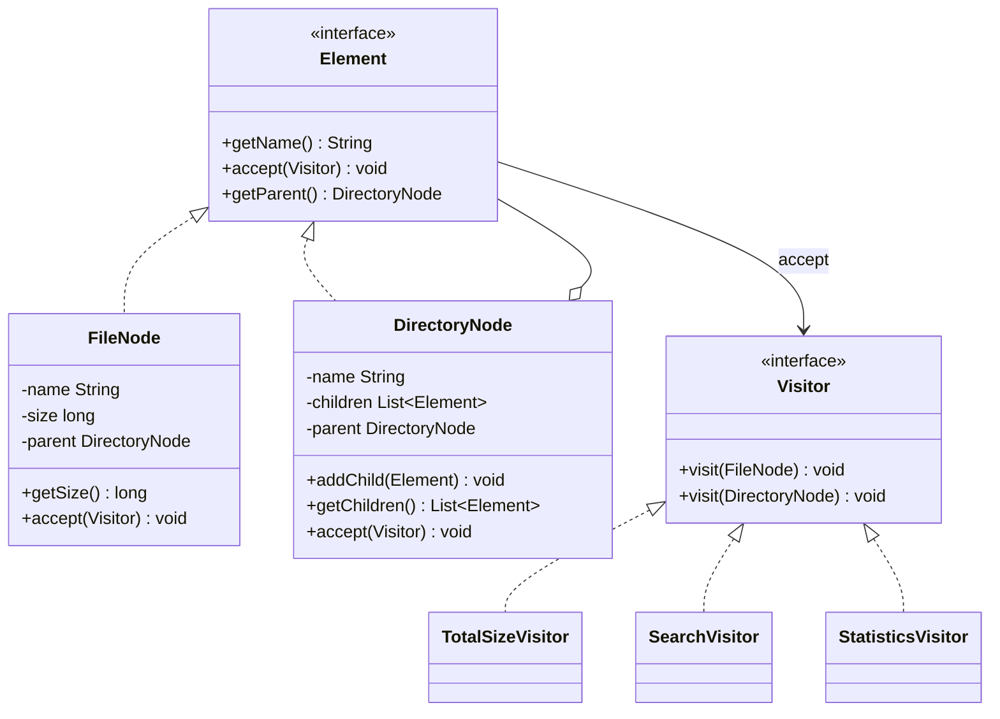

# Visitor Pattern — In-Memory File System

A Java 17 / Maven project demonstrating the **Visitor design pattern** on a hierarchical in-memory file system.

## Features

- Files store a name and a non-negative size in bytes.
- Directories contain files and other directories at arbitrary depth.
- Double dispatch through `Element.accept(Visitor)`.
- Three independent operations:
  - `TotalSizeVisitor` sums all file sizes in a subtree.
  - `SearchVisitor` searches by a configurable filename predicate and inclusive minimum size.
  - `StatisticsVisitor` counts files and directories and finds maximum depth.
- Tree rules prevent null children, duplicate sibling names, multiple parents and cycles.
- Child collections are exposed as unmodifiable lists.

## Requirements

- JDK 17+
- Maven 3.8+

## Run the application

From the project root:

```bash
mvn clean compile
mvn exec:java -Dexec.mainClass="com.aitu.visitor.Main"
```

## Run tests

```bash
mvn test
```

JUnit 5 tests cover invalid sizes and names, null children, duplicate names, parent ownership, cycles, encapsulation, recursive size calculation, inclusive search threshold, sorted paths, statistics and visitor reuse.

## Example output

```text
Total size: 1290 bytes
Search results: [root/documents/report.pdf, root/projects/Main.java]
Files: 4
Directories: 3
Maximum depth: 2
```

## Design

### Double dispatch

Each element implements `accept(Visitor)`. `FileNode` calls `visitor.visit(this)` with a `FileNode`, while `DirectoryNode` calls the overloaded method with a `DirectoryNode`. The concrete visitor method is selected without `instanceof`, casts, reflection or type-check chains.

### Traversal ownership

Traversal belongs to visitors. Each visitor's `visit(DirectoryNode)` iterates over the directory's read-only children and calls `accept(this)` on each child. Element classes define structure and dispatch, not algorithms.

### Extension

A new operation can be added as another `Visitor` implementation without changing `FileNode` or `DirectoryNode`. Adding a new element type requires a new overload in `Visitor` and corresponding implementations in each visitor.

### Clean Code decisions

1. **Meaningful names:** `TotalSizeVisitor`, `SearchVisitor` and `StatisticsVisitor` communicate their purpose.
2. **Single Responsibility:** nodes store file-system data; visitors implement separate operations.
3. **Small methods:** each `visit` method handles one element type and one operation.
4. **Encapsulation:** fields are private, children are unmodifiable from outside, and parent assignment is not a public API.
5. **Polymorphism:** overloaded visitor methods replace type-check chains.

## UML class diagram



## Tests

Test class: `FileSystemTest` (11 JUnit 5 tests).

## Repository

https://github.com/asadigamr132/Assigment_6_SDP
